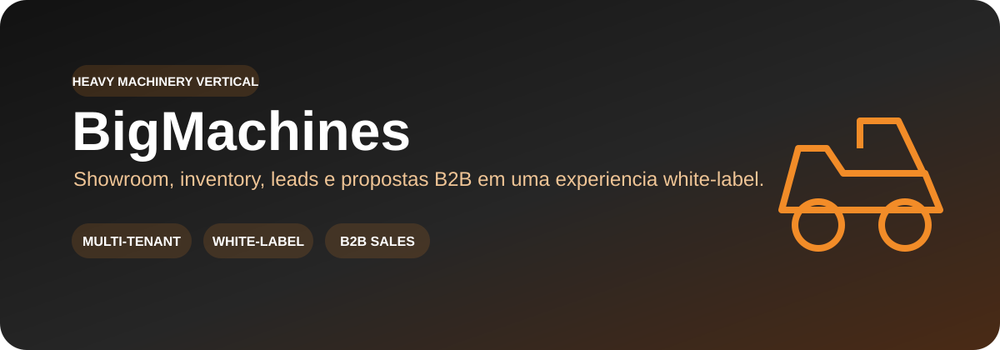
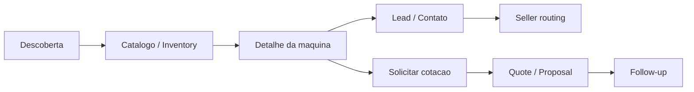

<p align="center">
  
</p>

<p align="center">
  
  
  
</p>

# BigMachines

Showroom digital premium para máquinas pesadas e peças industriais, em evolução para o **Heavy Machinery vertical** do Tupiniquim Vertical SaaS.

> A proposta SaaS preserva a experiência comercial do showroom, mas transforma catálogo, leads, propostas, identidade e integrações em dados/módulos por tenant.

## ✨ Visão do produto

| 🚜 Showroom & inventory | 🔎 Busca & descoberta | 🤝 Leads & CRM | 📄 Quotes & proposals |
| --- | --- | --- | --- |
| Máquinas, peças, categorias, disponibilidade e detalhes técnicos | Filtros e navegação orientada ao comprador B2B | Captação, roteamento comercial e histórico de oportunidade | Solicitação de cotação, proposta e follow-up comercial |

| 🔄 Trade-in | 🛠️ Suporte | 🎨 White-label | 📈 Operação SaaS |
| --- | --- | --- | --- |
| Fluxo preparado para avaliação de usado/entrada | Pós-venda e contato técnico por cliente | Marca, catálogo, mídia, contatos e domínio por tenant | Audit, observabilidade, entitlements e integrações compartilhadas |

## 🧭 Jornada B2B



## 🧩 Direção SaaS

O vertical compartilha um único núcleo para **tenancy, identidade/RBAC, Brand Studio, CMS, Media Manager, planos/entitlements, billing abstraction, CRM/leads, auditoria e observabilidade**. O catálogo industrial e os fluxos B2B permanecem modulares, sem fork de repositório por cliente.

```text
Tenant
 ├─ Branding / domínio / contatos
 ├─ Inventory / catálogo / mídia
 ├─ Leads / sellers / roteamento
 ├─ Quotes / propostas
 └─ Integrações / suporte
        ↓
     SaaS Core
```

## 🔐 Segurança e qualidade

- isolamento por tenant deve ser validado server-side;
- autorização comercial e administrativa não pode depender apenas do frontend;
- formulários públicos e geração de propostas precisam de rate limiting e validação;
- uploads e documentos comerciais devem ser tenant-aware;
- secrets ficam fora do Git;
- CI possui quality workflow, dependency audit e CodeQL;
- ausência de lint/test coverage completa continua sendo **release blocker**, não PASS implícito.

## 📚 Documentação

- [Plano do vertical SaaS](docs/SAAS_VERTICAL_PLAN.md)
- [Auditoria Tupiniquim Toolbox](docs/TOOLBOX_AUDIT_2026-09-10.md)
- [Checkpoints](docs/checkpoints/README.md)
- [Política de segurança](SECURITY.md)
- [Guia de substituição do cliente](CLIENT_REPLACEMENT_GUIDE.md)
- [Monorepo canônico — Sistema SaaS Geral](https://github.com/tupiniquimtechsolution-blip/Sistema-SaaS-Geral)

## 🚦 Estado real

O projeto possui um baseline visual e comercial funcional para showroom de máquinas. A evolução para SaaS deve manter esse frontend e mover dados e operações para contratos multi-tenant seguros. **Não declarar production-ready sem testes cross-tenant, autorização server-side, observabilidade, backup/rollback e gates verdes.**
